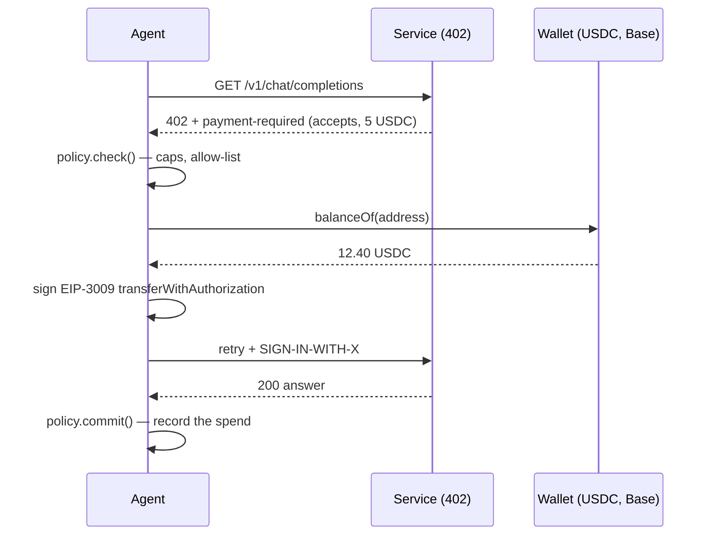

<div align="center">


# agent-x402

**x402 micropayments for AI agents — pay per API call in USDC on Base. No account, no API key, no subscription. With a spend policy a prompt injection cannot talk its way past.**

[](https://github.com/rustemmustafingovua-byte/agent-x402/actions/workflows/ci.yml)
[](https://www.npmjs.com/package/agent-x402)
[](./LICENSE)
[](https://nodejs.org)
[](https://base.org)

[**Docs**](https://rustemmustafingovua-byte.github.io/agent-x402/) · [Contributing](CONTRIBUTING.md) · [Security](SECURITY.md) · [Issues](https://github.com/rustemmustafingovua-byte/agent-x402/issues) · [Discussions](https://github.com/rustemmustafingovua-byte/agent-x402/discussions)

</div>

---

## The problem

x402 turns a `402 Payment Required` into a signed USDC transfer. That means an agent can buy inference, data and compute **without an account** — but it also means an agent can spend money. A model that can sign payments is one prompt injection away from draining a wallet.

`agent-x402` is the missing layer: a client that pays, and a policy that decides whether it may.

## Quick Start

```bash
git clone https://github.com/rustemmustafingovua-byte/agent-x402.git
cd agent-x402 && npm install
npm test
```

## Install

```bash
# tarball из релиза: без токена и без npm-логина
npm i -g https://github.com/rustemmustafingovua-byte/agent-x402/releases/download/v0.1.0/agent-x402-0.1.0.tgz
```

<details>
<summary>Через GitHub Packages (нужен токен со scope read:packages)</summary>

```bash
npm i -g @rustemmustafingovua-byte/agent-x402 --registry=https://npm.pkg.github.com
```

</details>
## Use

```js
import { X402Client, SpendPolicy, createAgentWallet } from "agent-x402"

const wallet = createAgentWallet()          // or load an existing key
const policy = new SpendPolicy({
  dailyUsd: 5,
  perRequestUsd: 0.5,
  allowPayees: ["0x2670b922ef37c7df47158725c0cc407b5382293f"],
})

const client = new X402Client({ privateKey: wallet.privateKey, policy })

const res = await client.fetch("https://api.venice.ai/api/v1/chat/completions", {
  method: "POST",
  body: { model: "claude-haiku-5-5", messages: [{ role: "user", content: "hi" }] },
})

console.log(res.paid, res.amountUsd, res.body)
```

## What the policy enforces

Rules live in code, outside the model:

| Rule | Example |
|

⭐ **Star us on GitHub** — it helps others find the project.
---|---|
| daily cap | `dailyUsd: 5` — at most $5 per UTC day |
| per-request cap | `perRequestUsd: 0.5` — one call may never exceed $0.50 |
| payment count | `maxPayments: 100` |
| allow-list | only these contract addresses may be paid |
| block-list | these assets are never paid (sandbox tokens, honeypots) |
| per-network cap | `perProviderUsd: { "eip155:8453": 2 }` |

`policy.check()` runs **before** signing; `policy.commit()` records what was actually spent. The day counter resets on the UTC day boundary.

## How the payment flows



## Under the hood

1. `GET`/`POST` the endpoint → `402` with a `payment-required` header (base64 JSON)
2. pick an accepted option (`eip155:8453` preferred, Solana supported)
3. `policy.check()` → refuse if it breaks the rules
4. check the USDC balance on Base
5. sign an **EIP-3009** `transferWithAuthorization` (USDC, `exact` scheme, 15-minute window)
6. retry with the signed payment in `SIGN-IN-WITH-X` / `X-PAYMENT` / `PAYMENT-SIGNATURE`

## Services that accept x402 today

| Service | What | Price |
|---|---|---|
| `api.venice.ai/api/v1` | Claude Haiku 5.5 / Sonnet 5.5 / Opus 5.5 | from $0.10 / 1M in |
| `pool.linkrra.com/v1` | open-weight models on their own GPUs, no key | from $0.001 / call |

## MCP server — wallet operations as tools

The private key stays inside the process; the policy is enforced before the
client signs anything.

```jsonc
// opencode.json
{
  "mcp": {
    "agent-x402": { "type": "local", "command": ["ax402-mcp"], "enabled": true }
  }
}
```

| Tool | What it does |
|---|---|
| `x402-wallet` | address + USDC balance (never the key) |
| `x402-quote` | what would this call cost — pays nothing |
| `x402-pay` | call + pay, policy enforced before signing |
| `x402-policy` | show or update caps, allow-list, blocked contracts |

## CLI

```bash
ax402 new                # create an agent wallet
ax402 balance            # USDC balance on Base
ax402 pay <url> [json]   # call any x402 endpoint, paying automatically
ax402 quote <url>        # show what a call would cost, pay nothing
ax402 policy             # show the current spend report
```

## Part of a portfolio

| Project | What it does |
|---|---|
| [`opencode-free-stack`](https://github.com/rustemmustafingovua-byte/opencode-free-stack) | route to free models, fall back automatically |
| [`free-web-mcp`](https://github.com/rustemmustafingovua-byte/free-web-mcp) | web search and page reading for agents, zero credits |
| [`agent-x402`](https://github.com/rustemmustafingovua-byte/agent-x402) | pay per API call in USDC with a spend policy |
| [`mcp-doctor`](https://github.com/rustemmustafingovua-byte/mcp-doctor) | check that MCP servers work, and say why they do not |
| [`mcp-proxy`](https://github.com/rustemmustafingovua-byte/mcp-proxy) | one endpoint, many MCP servers, with keys and limits |
| [`tool-schema-lint`](https://github.com/rustemmustafingovua-byte/tool-schema-lint) | lint MCP tool schemas before agents misuse them |
| [`prompt-budget`](https://github.com/rustemmustafingovua-byte/prompt-budget) | what does your system prompt cost per request? |
| [`agent-cost-guard`](https://github.com/rustemmustafingovua-byte/agent-cost-guard) | a budget in front of any OpenAI-compatible endpoint |
| [`opencode-doctor`](https://github.com/rustemmustafingovua-byte/opencode-doctor) | audit an OpenCode install in one command |
| [`free-tier-tracker`](https://github.com/rustemmustafingovua-byte/free-tier-tracker) | know your free quota before it runs out |
| [`x402-priceboard`](https://github.com/rustemmustafingovua-byte/x402-priceboard) | the price list of x402 endpoints, without paying |
| [`prompt-injection-guard`](https://github.com/rustemmustafingovua-byte/prompt-injection-guard) | find instructions hidden in files the agent reads itself |
| [`readme-doctor`](https://github.com/rustemmustafingovua-byte/readme-doctor) | why nobody uses your repository — checked in one command |

## Donate

MIT, forever. USDC on Base:

```
0x8aC6a229f254980CCd3Dd35CF5E1B7c08880B40E
```

## Roadmap

- [x] x402 v2 "exact" scheme on Base (EIP-3009)
- [x] spend policy: caps, allow-list, block-list, per-network
- [x] CLI and tests
- [x] MCP server exposing wallet and policy operations
- [x] policy file (`~/.config/agent-x402/policy.json`)
- [ ] Solana USDC (SPL) signing
- [ ] spend report exporter (CSV/JSON) for accounting
- [ ] hosted relay with a take rate

## Support

Every tool here is MIT and free. If it saved you time, you can support the work:

- **USDC (Base):** `0x8aC6a229f254980CCd3Dd35CF5E1B7c08880B40E`
- **GitHub Sponsors:** https://github.com/sponsors/rustemmustafingovua-byte

Paid tiers of the hosted services are billed per call in USDC (x402) — no accounts, no keys.

## Monetization

This project earns through x402 micropayments, API key tiers, and hosted subscriptions. See package.json `funding` field and the live deployment for pay-per-call pricing.

---

## License

MIT © rustemmustafingovua-byte
